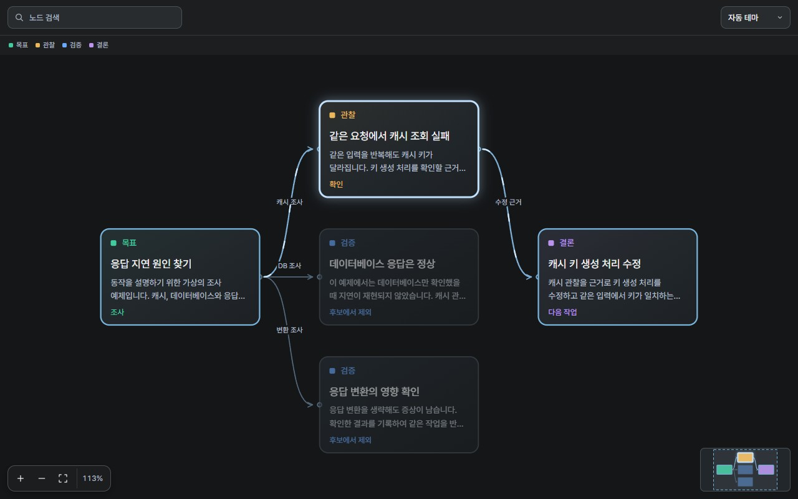

# Graph Viewer

**Codex에서 코드 구조와 조사 과정을 탐색하는 그래프 뷰어.**

모듈의 의존관계, 조사 결과의 근거, 다음 작업으로 이어지는 경로를 그래프로 확인합니다.
Windows Codex Desktop의 그래프 탭에서 사용합니다.



## 🧭 왜 필요한가

긴 대화에서 결론을 찾는 것과 그 결론의 근거를 확인하는 것은 다른 일입니다.
어떤 관찰이 수정으로 이어졌는지, 어느 조사 분기를 확인했는지, 변경할 모듈과 무엇이 연결되는지 다시 읽어야 합니다.

Graph Viewer는 이런 관계를 한 화면에 표시합니다.
노드를 선택하면 전체 선행 경로와 후행 경로가 강조되어, 관련 내용을 따라가며 확인할 수 있습니다.

| 작업 | 그래프로 확인할 내용 |
|---|---|
| 장애 조사 | 증상 → 관찰 → 검증 → 수정의 연결 |
| 코드 구조 탐색 | 모듈 간 호출과 의존관계 |
| 설계 검토 | 요구사항, 설계 선택과 근거 |

## ✨ 주요 기능

- **연결 경로 강조:** 선택한 노드와 연결된 전체 경로, 흐름 애니메이션.
- **미니맵:** 전체 구조, 선택한 경로와 현재 보고 있는 영역.
- **검색과 툴팁:** 검색창 안의 X 버튼으로 필터를 지우고, 노드 옆에서 긴 제목, 설명과 출처 확인.
- **확대와 이동:** 전체 맞춤, 100% 보기와 배율을 유지하는 더블클릭 중심 이동.
- **배치 선택:** 계층형, 트리형, 방사형과 네트워크형. 계층형과 트리형은 가로와 세로 전환.
- **그룹 표시:** Mermaid subgraph의 제목, 중첩 테두리, 접기와 펼치기.
- **라이트와 다크 테마:** 앱 테마를 따르거나 그래프 상단에서 직접 선택.
- **그래프 갱신:** 열린 탭에서 새 자료 반영.
- **여러 뷰어:** 한 채팅에서 여러 그래프를 함께 열고 각각의 연결 유지.
- **이미지 저장:** 현재 배치, 테마와 선택 강조를 담은 전체 그래프를 PNG로 저장.
- **상태 저장:** 프로젝트와 채팅별 그래프, 선택, 확대, 이동과 검색 상태 보관.
- **Mermaid와 JSON:** Mermaid 흐름도 또는 상세 정보를 포함한 그래프 JSON 사용.

## 📦 설치

GitHub marketplace를 등록한 뒤 플러그인을 설치합니다.

```powershell
codex plugin marketplace add semisemil/graph-viewer --ref main
codex plugin add graph-viewer@graph-viewer
```

설치한 플러그인이 표시되지 않으면 Codex를 다시 엽니다.
명령의 사용법은 [Codex 공식 설치 안내](https://learn.chatgpt.com/docs/developer-commands#codex-plugin-marketplace)를 참고하세요.

## 🚀 사용법

설치한 스킬에 그래프 생성을 요청합니다.

```text
$graph-viewer:graph-viewer
이 프로젝트의 주요 모듈과 의존관계를 그래프로 보여줘.
```

```text
지금까지 확인한 관찰, 검증 결과와 수정 작업을 그래프로 정리해줘.
각 결론을 뒷받침하는 근거를 연결해줘.
```

```text
examples/request-latency.mmd를 그래프 탭으로 열어줘.
```

이미 열린 그래프에 결과를 추가하거나 상태를 갱신할 수도 있습니다.

### 배치 방식과 방향

그래프 상단에서 배치를 선택합니다.
배치를 바꾸면 전체 구조에 맞춰 화면을 조정하며, 선택한 노드와 검색어는 유지합니다.

| 배치 | 적합한 구조 |
|---|---|
| 계층형 | 작업 순서와 의존관계 |
| 트리형 | 여러 시작점에서 하위 항목으로 나뉘는 구조 |
| 방사형 | 시작점 주변으로 관계를 펼쳐 보는 구조 |
| 네트워크형 | 상호 연결과 순환이 많은 구조 |

가로와 세로 방향은 계층형과 트리형에 적용합니다.
배치 방식과 방향은 그래프별로 저장하며, 다시 열면 복구합니다.
트리형에서도 여러 부모와 순환 연결을 포함한 원본 관계는 모두 표시합니다.

### 여러 그래프 열기

한 채팅에서 여러 그래프를 각각 열 수 있습니다.
새 그래프를 열거나 갱신해도 기존 뷰어는 처음 연 그래프에 계속 연결됩니다.
다른 그래프의 선택, 배치와 탐색 위치는 서로 영향을 주지 않습니다.
같은 그래프를 여러 뷰어에서 열면 선택과 보기 상태를 공유합니다.

### 그룹 접기와 펼치기

그룹 제목 오른쪽의 화살표를 누르면 내부 노드를 하나의 그룹 카드로 접습니다.
외부 연결선은 그룹 카드에 붙고, 내부 연결선은 펼칠 때 다시 나타납니다.
카드 오른쪽 위의 화살표로 그룹을 펼칠 수 있습니다.

부모 그룹을 접었다 펼쳐도 자식 그룹의 접힘 상태는 유지합니다.
접은 상태는 그래프별로 저장하며, 미니맵과 PNG 이미지에도 반영합니다.
접힌 그룹 안의 노드를 검색하면 해당 그룹 카드를 표시합니다.

### 이미지 저장

상단의 **이미지 저장** 아이콘을 누르면 전체 그래프를 PNG 파일로 저장합니다.
현재 배치, 테마, 선택 강조와 그룹 접힘 상태를 유지하며 화면 밖의 노드와 그룹도 포함합니다.
큰 그래프는 이미지 크기 한도에 맞춰 축소합니다.

### Mermaid 입력

다음과 같은 Mermaid 흐름도를 그래프 뷰어로 볼 수 있습니다.


`flowchart`와 `graph`의 노드, 연결, 라벨을 읽어 뷰어의 카드와 선으로 표시합니다.
`subgraph`는 제목과 테두리로 표시하며, 중첩 그룹과 그룹에 연결한 관계도 유지합니다.
그룹 내부와 그룹 간 배치는 뷰어에서 선택한 배치 방식을 따릅니다.
Mermaid의 개별 도형과 스타일은 그대로 재현하지 않습니다.
상세 설명, 상태와 출처가 필요하면 [그래프 JSON 형식](skills/graph-viewer/references/graph-format.md)을 사용합니다.

## 💾 저장 위치

그래프와 보기 상태는 작업 프로젝트의 **`.graph-viewer/`**에 저장합니다.
프로젝트 안에서도 채팅별로 자료를 구분합니다.
플러그인을 교체해도 프로젝트의 자료는 유지됩니다.

이 폴더에는 생성 시 Git 제외 설정이 들어갑니다.
공유할 원본 `.mmd`나 `.json` 파일은 프로젝트의 원하는 위치에 두면 됩니다.

## 🖥️ 지원 범위

- Windows Codex Desktop의 로컬 MCP 플러그인과 별도 그래프 탭.
- 그래프당 최대 1 MiB, 노드 500개, 관계 2,000개와 그룹 500개.
- 서버 재연결과 그래프 재열기에서 상태 복구 확인.
  Codex 앱 전체 종료 후 복구 검증은 남아 있습니다.

## 🛠️ 개발

개발 소스와 검사는 `dev` 브랜치에서 관리합니다.
`main` 브랜치에는 설치할 플러그인을 저장소 루트에 배치합니다.
소스 수정, 플러그인 빌드와 검사는 [개발 안내](docs/development.md)를 참고하세요.
표시 엔진은 MCP와 분리되어 자체 HTML 화면에서도 사용할 수 있습니다.

- [아키텍처](docs/architecture.md)
- [에이전트용 사용 스킬](skills/graph-viewer/SKILL.md)
- [그래프 JSON 형식](skills/graph-viewer/references/graph-format.md)

## 📄 라이선스

[MIT](LICENSE) 라이선스로 배포합니다.
포함된 외부 라이브러리의 라이선스는 배포본의 [THIRD_PARTY_NOTICES.txt](https://github.com/semisemil/graph-viewer/blob/main/THIRD_PARTY_NOTICES.txt)에 있습니다.
