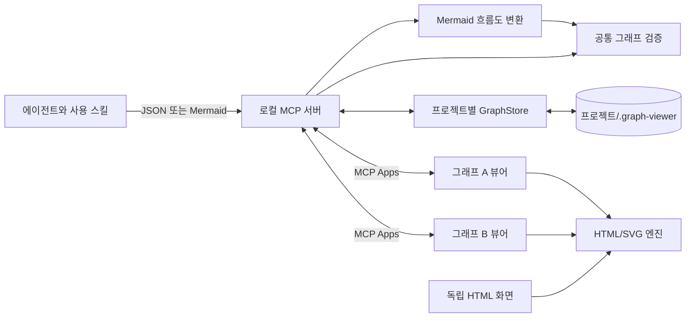

# Graph Viewer 아키텍처

Graph Viewer는 입력 자료, 표시 엔진과 Codex 연결부로 구성된다.
자료의 의미는 작성자가 정하고, 표시 엔진은 노드와 관계를 탐색하는 화면을 제공한다.

## 구성과 책임

아래 구현 경로는 dev 브랜치의 소스를 기준으로 한다.
main 브랜치의 src/mcp.mjs는 MCP 서버, Mermaid 변환과 저장소를 포함한 실행 번들이다.



| 구성 | 책임 | 구현 |
|---|---|---|
| 공통 모델 | 입력 검증, 연결 경로와 자동 배치 | src/model.js |
| 표시 엔진 | 선택, 검색, 확대, 상세 보기와 미니맵 | src/renderer.js |
| Mermaid 변환 | 공식 흐름도 파서로 노드와 관계 추출 | src/mermaid.mjs |
| MCP 연결 | 호출 프로젝트 선택, 채팅 식별과 UI 전달 | src/mcp.mjs, web/mcp.html |
| 저장소 | 문서 버전, 보기 상태와 화면 세션 저장 | src/store.mjs |
| 배포 | 서버 번들, 실행기, 사용 스킬과 marketplace | scripts/build-plugin.mjs, plugins/graph-viewer |

엔진은 MCP, Codex DOM과 파일 저장에 의존하지 않는다.
JSON은 설명, 상태와 출처를 표현한다.
Mermaid는 flowchart와 graph의 연결 구조를 같은 JSON으로 변환한다.
subgraph의 제목, 직접 포함한 노드와 부모 그룹을 공통 JSON으로 변환한다.
엔진은 그룹별 배치 영역과 중첩 테두리를 계산하며, 그룹을 가리키는 연결은 그 테두리에 표시한다.
개별 도형과 스타일은 변환 대상이 아니다.

## 프로젝트와 채팅 연결

모델 도구는 projectPath로 작업 프로젝트의 절대 경로를 받는다.
서버는 실제 경로를 확인하고 해당 프로젝트의 .graph-viewer에 GraphStore를 연다.
채팅 ID는 MCP 호스트의 요청 메타데이터에서 읽는다.

동일한 프로젝트와 채팅 안에서 graphId로 그래프를 구분한다.
UI는 처음 열린 프로젝트, 채팅과 그래프에 고정된다.
연결이 성립한 뒤 도착한 다른 열기 결과는 적용하지 않는다.
저장소는 그래프마다 연결 토큰을 보관하고, 같은 그래프를 다시 열 때 재사용한다.
새 그래프를 열거나 등록해도 기존 연결의 대상은 바뀌지 않는다.
activeGraphId는 그래프 ID를 생략한 모델 도구 호출의 기본값이다.
UI의 조회, 상태 쓰기와 적용 보고는 연결 토큰으로 찾은 그래프에만 적용한다.
graph_status.lastReport도 요청한 그래프의 적용 보고를 반환한다.

기존 GRAPH_PANEL_DATA_DIR 설정은 projectPath가 없는 호출에만 사용한다.
기존 자료를 자동 이동하지 않는다.

## 저장과 복구

```sequenceDiagram
    participant Agent as 에이전트
    participant MCP as MCP 서버
    participant Store as 프로젝트 저장소
    participant UI as 그래프 탭
    Agent->>MCP: graph_status(projectPath, graphId)
    MCP-->>Agent: revision
    Agent->>MCP: graph_publish(자료, expectedRevision)
    MCP->>Store: 버전 확인 후 저장
    MCP-->>Agent: committed, revision
    Agent->>MCP: open_graph(projectPath, graphId)
    MCP-->>UI: 그래프, 상태, 화면 세션
    UI->>MCP: graph_view(sync 또는 action)
    MCP<->>Store: 그래프 조회 또는 보기 상태 저장
    MCP-->>UI: 저장된 상태
```

동시 저장은 채팅별 Windows 명명된 파이프 잠금과 버전 검사로 제어한다.
문서 교체 전에 정상본을 백업한다.
백업 복구 시 이전 UI 세션의 저장 권한은 복구하지 않는다.

선택한 노드는 그래프에 저장하고, 카메라, 검색과 배치는 summary 또는 large 보기별로 저장한다.
MCP 뷰어는 large 보기를 사용하므로 같은 그래프를 열면 이 상태를 공유한다.
다른 그래프의 상태는 분리한다.
이전 단일 연결 형식은 저장된 활성 그래프의 연결로 읽는다.
그래프 갱신 시 남아 있는 선택과 위치를 유지한다.
서버 재연결과 그래프 재열기에서 저장 상태를 복원한다.
Codex 앱 전체 종료 후 복구는 추가 검증이 필요하다.

## 실행과 배포

Codex가 플러그인의 PowerShell 실행기를 시작한다.
실행기는 Codex 번들 Node를 우선 사용하며 없으면 PATH의 Node를 찾는다.
원시 바이트 스트림으로 MCP 입출력을 전달한다.
연결이 닫히면 서버를 종료한다.
실행기가 강제로 종료되어 연결 종료가 전달되지 않는 경우에는 서버가 부모 프로세스의 종료를 확인하고 저장 작업을 마친 뒤 종료한다.

배포 서버는 실행 의존성을 포함한 번들과 청크로 구성된다.
Mermaid 코드는 첫 Mermaid 입력을 처리할 때 불러온다.
사용자는 npm 설치나 소스 빌드를 하지 않는다.
dev 브랜치에서 빌드하면 plugins/graph-viewer 폴더를 생성한다.
개발용 marketplace는 이 폴더를 참조한다.
검사를 통과한 배포본은 main 브랜치의 루트에 배치한다.
main의 marketplace는 루트의 플러그인을 참조한다.

## 독립 화면

독립 HTTP 화면과 CLI는 같은 엔진과 저장소를 사용한다.
Codex 앱의 그래프 탭은 MCP로 연결한다.

엔진 API와 기존 HTTP/CLI 계약은 [명령과 데이터 계약](architecture-contracts.md)을 참고한다.
