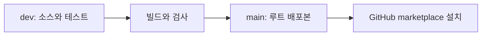

# 개발 안내

개발은 `dev` 브랜치에서 진행합니다.

| 브랜치 | 내용 |
|---|---|
| dev | 개발 소스, 테스트와 빌드 스크립트 |
| main | 루트에 배치한 실행 플러그인과 사용자 문서 |



## 준비와 빌드

소스 개발에는 Node.js 22.12 이상과 npm이 필요합니다.
플러그인 사용자는 아래 빌드 과정을 실행하지 않습니다.

```powershell
git switch dev
npm ci --ignore-scripts
npm test
```

npm test는 먼저 플러그인을 빌드한 뒤 검사합니다.
빌드만 실행하려면 npm run build:plugin을 사용합니다.
빌드는 plugins/graph-viewer의 서버 번들, 렌더러, 실행기와 스킬을 갱신합니다.
배포 폴더에 외부 node_modules는 필요하지 않습니다.
이 생성 폴더는 dev 브랜치의 Git 추적에서 제외합니다.

## 배포 브랜치 갱신

dev의 변경을 커밋한 뒤 실행합니다.

```powershell
npm run release
```

이 명령은 플러그인을 빌드하고 검사한 뒤 main 브랜치에 배포 커밋을 만듭니다.
현재 작업 폴더는 dev에 유지합니다.
main에는 서버, 렌더러, 스킬과 문서를 배치하며 marketplace는 저장소 루트의 플러그인을 가리킵니다.
배포용 임시 파일은 운영체제의 임시 폴더에 만들고 작업이 끝나면 삭제합니다.
원격 저장소로 올리는 작업은 별도로 진행합니다.

## 검사

기본 검사는 CLI, HTTP, MCP와 Mermaid 입력을 다룹니다.
프로젝트별 저장, 상태 복구, 이동한 배포본과 PATH에 Node가 없는 실행도 확인합니다.
같은 채팅의 여러 MCP 뷰어에서 그래프별 연결, 상태 분리와 닫은 화면의 재열기를 확인합니다.

브라우저 통합 검사는 GRAPH_PANEL_PLAYWRIGHT에 Playwright 패키지의 절대 경로를 지정하면 실행합니다.
GRAPH_PANEL_CHROMIUM에는 사용할 Chromium 실행 파일을 지정할 수 있습니다.
렌더러의 별도 검사는 scripts/verify-browser.mjs에서 실행합니다.

### 성능과 종료 검사

아래 명령은 dev 브랜치에서 실행합니다.
브라우저 검사의 환경 변수를 지정한 뒤 배포본을 빌드합니다.

```powershell
npm run build:plugin
npm run benchmark -- --launcher=true --soak-seconds=600 --output='<결과 JSON 절대 경로>'
npm run verify:shutdown -- --repeat=10
```

성능 검사는 최대 500개 노드와 2,000개 연결, 긴 설명과 순환 그래프를 다룹니다.
생성과 제거 100회, MCP 화면 재열기 30회, 동시 4개 뷰와 연속 사용 중의 힙과 DOM 수를 기록합니다.
메모리는 가비지 수집 후 측정하며, 테스트 프로젝트는 운영체제 임시 폴더에 만들고 종료 시 삭제합니다.
`--performance-only=true`는 프레임과 처리 시간만 측정합니다.
`--source-ref=<Git ref>`는 해당 버전의 엔진 소스로 비교합니다.
`--entry=<server.mjs 절대 경로>`는 비교할 배포 서버를 지정합니다.
`--launcher=true`는 PowerShell 실행기와 Codex 번들 Node로 MCP 서버를 시작합니다.
측정 조건과 이번 결과는 [성능과 수명 검증](performance.md)을 참고하세요.

종료 검사는 독립된 시험용 호스트와 그 자식 프로세스만 종료합니다.
실제 Codex 종료는 다음과 같이 이전 프로세스의 PID와 생성 시각을 저장한 뒤, 앱을 완전히 종료하고 다시 열어 확인합니다.

```powershell
npm run verify:shutdown -- --capture='<종료 확인 JSON 절대 경로>'
# Codex를 완전히 종료한 뒤 다시 엽니다.
npm run verify:shutdown -- --check='<같은 JSON 절대 경로>'
```

## 개발용 패키지 복사

설정을 따로 시험하려면 다음 명령으로 새 패키지 폴더를 만듭니다.

```powershell
node scripts/package-mcp.mjs --output '<새 패키지 절대 경로>'
```

--data-dir와 --log는 기존 저장 경로나 진단 파일을 명시하는 개발 옵션입니다.
기본 설치는 도구가 전달한 프로젝트 안에 자료를 저장합니다.

설치 명령은 [README](../README.md#-설치)를 참고하세요.
등록용 Codex CLI 명령은 그래프 기능의 실행 의존성이 아닙니다.
배포 절차는 [공식 플러그인 문서](https://developers.openai.com/plugins/build/plugins)를 따릅니다.

## MCP 프로토콜

서버는 2026-07-28과 이전 프로토콜의 호환 경로를 제공합니다.
현재 검증한 Codex 번들에서 새 프로토콜을 사용하려면 mcp_2026_07_28 기능 설정이 필요합니다.
graph_status의 protocolVersion으로 실제 연결 버전을 확인합니다.

## 엔진 직접 사용

높이가 지정된 HTML 컨테이너에서 src/model.js와 src/renderer.js를 로드합니다.

```javascript
const view = GraphPanel.mount(container, {
  graph,
  compact: false,
  onAction(action) {
    // 애플리케이션의 저장 경로에 연결합니다.
  }
});
view.update(nextGraph);
view.destroy();
```

compact:true는 좁은 화면에 맞는 세로 배치입니다.
자료 공급과 상태 저장은 엔진을 사용하는 애플리케이션이 담당합니다.
